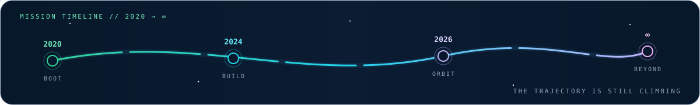

## 🛰️ Mission control

> The pinned cards below are the **artifacts**. This is the **flight plan**.

<table>
  <tr>
    <td align="center" width="90">🧠</td>
    <td align="left"><b>Language</b> SNSX — a programming language with its own compiler and security reasoning built into the toolchain, not bolted on afterwards.</td>
  </tr>
  <tr>
    <td align="center">🧱</td>
    <td align="left"><b>Systems</b> Kernels, terminals and operating systems written from first principles in C and assembly.</td>
  </tr>
  <tr>
    <td align="center">🛡️</td>
    <td align="left"><b>Security</b> The belief that security is a property of the whole design, never a final checkbox.</td>
  </tr>
  <tr>
    <td align="center">🤖</td>
    <td align="left"><b>Intelligence</b> SNSAI systems that teach, reason and act — from guided learning to AI-driven commerce.</td>
  </tr>
  <tr>
    <td align="center">🎓</td>
    <td align="left"><b>Education</b> LEOU — a production platform where identity, entitlement and interactive 3D explanation meet.</td>
  </tr>
  <tr>
    <td align="center">🌍</td>
    <td align="left"><b>Space</b> NASA Space Apps work mapping Earth locations as analogues for permanent Moon-base sites and Martian environments.</td>
  </tr>
</table>

## 🚀 Currently in orbit

- **[SNSX Programming Language](https://github.com/sahusatya2008/SNSX-Programming-Language-Stage-I)** — a language, compiler and built-in security analysis engine in Rust.
- **[SNSX OS Stage IV](https://github.com/sahusatya2008/SNSX-OS-Stage-IV)** — a new-generation OS with its own kernel and the SNSX language.
- **[SNSX SecurityOS](https://github.com/sahusatya2008/SNSX-SecurityOS)** — a security-first operating system line built from the ground up.
- **[moon-mars-analouge (SNSX SPACE)](https://github.com/sahusatya2008/moon-mars-earth-analogs)** — NASA Space Apps analogue mapping: Earth locations, satellite data, permanent Moon-base sites and Martian environments.
- **[LEOU Advance Learning](https://github.com/sahusatya2008/leou-advance-learning)** — biometric login, manual UPI billing and interactive 3D courses for students.

## 🧰 Constellation

## 📡 Telemetry

The graph grows every time something ships.

## 🧭 Connect

**Designed in SNSX SPACE · written in public · 2020 → ∞**

 

If you made it this far — thank you for looking at the work, not just the stars.

